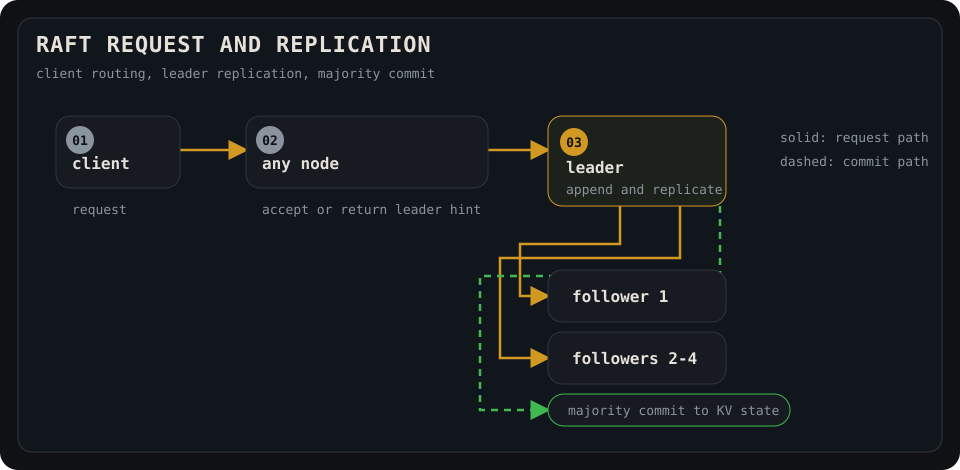

# raft-kv

A from-scratch Raft implementation in Rust with a deterministic simulator and real processes over raw TCP.

## Measured simulator behavior

| Metric | Value |
| --- | ---: |
| First leader elected | 176 ms simulated |
| Failover after leader kill | 244 ms simulated |
| Write visible on all five nodes | 52 ms simulated |
| Fault tolerance | 2 failed nodes |
| Process-level TCP tests | 3 |

These are deterministic simulator timings, not wall-clock distributed-system performance.

The simulator controls time, messages, partitions, duplication, reordering, stops, and restarts.
The process runner adds framed TCP, atomic Raft persistence, and a state machine recovered from the durable log and validated snapshots.

<table>
  <tr>
    <td></td>
    <td></td>
  </tr>
</table>

## Current boundary

- Three to five nodes
- Majority-committed writes and current-term read barriers
- Durable term, vote, log, snapshot boundary, and state-machine recovery
- Deterministic histories with linearizability checks
- No membership changes, TLS, authentication, or production claim

[Run a cluster, test failures, and read the limits](GUIDE.md).

## Build

See [GUIDE.md](GUIDE.md) for commands and requirements.

## Verification

`ci.yml` runs formatting, Clippy with `-D warnings`, all-target tests, and a release build.
It is functional evidence; the simulator timings above are labeled to the simulator, not to real networks.

## Limitations

- No membership changes, TLS, authentication, or exactly-once claims beyond Raft's own guarantees.
- Reads go through the current leader; there is no follower read path.
- Simulator semantics describe the project's own message model, not IP networks.
